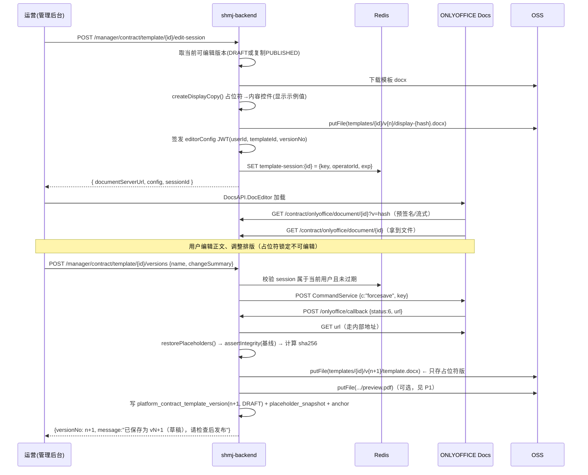

# 合同模板自定义 + 版本管理 + 商品选模板 + 在线签署：接入 shmj-backend 方案

> 文档性质：接入设计方案（不是代码交付）
> 依据：
> - Demo 项目：`pdf-contract-demo 2`（ONLYOFFICE Docs 内容控件保护 + 占位符还原 + 版本快照 + DOCX→PDF）
> - 后端项目：`/Users/dream/work/shmj-backend`（Spring Boot 3.5.9 / Java 21 单体，法大大电子签 v5）
> 扫描日期：2026-10-27

---

## 0. 结论先行

| 结论 | 说明 |
|---|---|
| **不要整体移植 Demo 的代码** | Demo 是「单个 Word 模板 + 磁盘目录 + 一张表」的原型；后端是「多租户 + 多版本 + 法大大签署 + OSS」的生产系统。逐行搬运会把磁盘状态、无租户隔离、无并发控制带进生产。 |
| **要移植的是 Demo 的三个「机制」** | ① ONLYOFFICE 编辑会话（内容控件显示业务值、`w:tag` 保存原始占位符）；② 保存回调「还原占位符 → 校验占位符集合 → 拒绝缺失去改」；③ 用 `forcesave` + 回执做「开启编辑 → 保存版本」的一致性。 |
| **模板版本治理必须新建，不能复用** | 现在后端只有 `fasc.templates.contractTemplatePath` 一个配置路径，模板变更要改仓库重启。而且最致命的隐藏约束是：**`ContractTask` 里两份合同章的坐标是写死在 DOCX 第 6 页的**，一旦允许用户自定义模板，签名区位置必然漂移 → 必须一并做「签署字段定位 + 保存时校验」。 |
| **版本锚点应挂在商品版本上** | 后端已有 `platform_product_version` + `platform_order.product_version`。模板绑定放进商品版本快照，下单时随订单快照，`ContractTask` 按 `order.product_version` 取模板——一期改动最小，且天然保证「合同与下单时的商品快照一致」。 |
| **签署链路不用换** | 升级点只是：生成 DOCX 时按订单快照的模板版本渲染（而不是读取配置路径），之后 `uploadFileByURL → processFile → createContractSignTask → 回调` 保持原样。 |
| **合规模块可放在管理端** | 模板编辑与版本管理归运营（管理端），企业只做「选择模板」。理由是：法大大发起合同的是平台自己的 `initiator` openCorpId，且合同签章类型由 `shmj.seal-usage.contract-seal-type` 统一约束，模板属于平台级资产。 |

**一句话架构**：`平台运营在管理后台用 ONLYOFFICE 编辑模板 → 保存即生成不可变版本（占位符集合校验 + 签署字段校验）→ 商品上架（选模板）→ 审核通过时商品版本冻结模板版本 → 下单时订单冻结商品版本 → ContractTask 按冻结版本渲染 DOCX → 法大大签署 → 回调落章`。

---

## 0.5 代码验证结论（修正前文的假设）

写方案后对两个仓库做了逐点核对，以下**推翻了初稿里的几个判断**，以本节为准。

| # | 初稿假设 | 实际情况 | 影响 |
|---|---|---|---|
| V1 | 需要移植 Demo 的 `PlaceholderProtectionService`（487 行） | 后端 `utils/SdtTemplateUtil` **已经实现**了同样机制：`normalize()` 把 `{<$.x>}` 转成锁定内容控件（`w:lock=sdtContentLocked`）并把 **tag 设为 JsonPath**（`seller.name`），且已覆盖 **正文 + 页眉页脚**；`fillSdt()` 按 tag 填值；现有 `WordTemplateUtil.fillTemplateByPoiTl` 已改造为「先 `fillSdt` 再 poi-tl」 | 只需补一个反向工具 `SdtTokenRestoreUtil`（展示值 → 占位符），约 250 行，**不需要移植 487 行** |
| V2 | `SdtTemplateUtil` 是已合入代码 | 它是**工作区未提交的新文件**（`git status: ?? SdtTemplateUtil.java`），说明这条能力正在建设、方向与本方案一致 | 方案应当**顺接**这条线，而不是另起一套；落地时要与原作者对齐接口 |
| V3 | 签章位置需要自研「渲染后分页定位」 | 法大大 SDK `FieldPosition` 支持 `positionMode = keyword`，`PositionModeEnum.KEYWORD("keyword")`，还有 `positionKeyword` + `keywordOffsetX/Y`；`DocClient.getKeywordPosition(GetKeywordPositionReq)` 对应 `POST /file/get-keyword-positions`，返回**页码 + 坐标 + 矩形** | **不需要自研分页定位**。发布时用官方接口反查校验唯一性，签署时交给法大大定位。原 R1（章盖错位）从"必踩"降为"发布时拦住" |
| V4 | 模板作为 jar 资源打包，改模板要重新构建 | `fasc.templates.contractTemplatePath = templates/contracts/contract-template-v1.docx` 是 **OSS key**，由 `fileStorage.getFile(key)` 读取；仓库内**没有任何 .docx** | "模板入库"不是搬文件，而是给 OSS 上的模板加版本台账；上线只需写一条 INSERT 指向已有 key |
| V5 | 模板编辑应归平台（企业端） | 法大大发起合同用平台自己的 `initiator` openCorpId，`shmj.seal-usage.contract-seal-type` 统一约束签章类型 | 维持初稿结论：**模板治理归管理端**，企业只做选择；企业私有模板需配套审核，放二期 |
| V6 | 模板选择直接挂在商品上 | `ProductVersionService.buildVersionFromProduct(product, announce, ...)` 已把公告表字段快照进版本表（收款账户、售卖时间等）；且模板选择发生在**上架时**（早于审核通过建版本） | 模板选择先落 `platform_fixed_announce`，审核通过建版本时再带进 `platform_product_version`，与保证金/交易费规则**完全同构** |
| V7 | `DelayTaskManager` 可用于模板保存 | 任务表队列容量 1 + `DiscardOldestPolicy`，且 `local` profile 直接跳过执行 | 模板保存/回调**必须同步处理**，不进任务表（初稿结论正确，此处补充依据） |

> 另外核对到一个容易踩的坑：`FileStorage.putFile(key, bytes, overwrite, headers)` 的第三参
> **语义是反的**（`overwrite=true` 会写 `x-oss-forbid-overwrite:true`，即**禁止**覆盖）。
> 因此版本文件用 `true`（保护不可变），暂存/展示副本必须用 `false`，否则第二次保存直接失败。


---

## 1. 现状盘点

### 1.1 后端已有能力（可直接复用）

| 能力 | 位置 | 说明 |
|---|---|---|
| DOCX 模板渲染 | `service/template/TemplateComponent#fillContractTemplate`（`utils/WordTemplateUtil#fillTemplateByPoiTl`） | poi-tl 语法 `{<$.path>}`；`SdtTemplateUtil.fillSdt` 已能按 `w:tag` 填充内容控件，这是 ONLYOFFICE 回写模板能无缝接入的前提 |
| 字段数据模型 | `service/template/V1ContractParam` | 30+ 占位符（`seller.name`、`product.unitPrice`、`signDate`…），由订单 + 商品版本 + 企业 + 银行拼装，并做 Bean Validation |
| 签署 | `external/impl/FascOpenApi` / `FascOpenDefaultApi` | `uploadFileByURL`、`processFile`、`createContractSignTask`、`getSignTaskURL`、`abolishTask`、`cancelTask` |
| 签署回调 | `task/fasc/callback/ContractSignTaskProcessor` | 按 `FascReferenceIdGenerator.referenceId` 路由，`task/finished` 时把盖章 PDF 落到 `contracts/{id}/signed.pdf` |
| 异步任务 | `platform_task` + `task/manager/DelayTaskManager`（2 分钟轮询 + Redisson 锁） | 合同生成任务 `ContractTask` 已挂在 `order → contract` 事件上 |
| 商品版本 | `platform_product_version` + `ProductVersionService` + `platform_product.current_version` + `platform_order.product_version` | 已有「审核通过建 v1 / 编辑建 vN / 下单快照」的完整机制 |
| 文件存储 | `external/FileStorage`（OSS，`putFile/putTempFile/getFile/generatePresignedUrl`） | 模板文件应走这里，不要落磁盘 |
| 上传 | `POST commons/file/upload` | **当前 Tika 白名单只有图片和 PDF，DOCX 校验被注释掉** → 需要新增一个专用模板上传接口 |

### 1.2 缺口清单

| # | 缺口 | 影响 | 优先级 |
|---|---|---|---|
| G1 | 没有 ONLYOFFICE Document Server，也没有 JWT 签发/回调验签 | 无法在线编辑 | P0 |
| G2 | 模板只有 `fasc.templates.contractTemplatePath` 一个路径，**没有版本概念** | 改模板 = 改仓库发版；历史合同无法追溯用的哪版 | P0 |
| G3 | `ContractTask` 签署字段**写死页码坐标**（甲方 `page6 (520,750)/(520,900)`，乙方 `page6 (200,750)/(200,900)`，骑缝章 `y=400/800`） | 用户一改模板，印章可能压到正文或落到空白页；`processFile` 不会报错，签完才发现 | **P0（最大风险）** |
| G4 | 模板里缺一个稳定的「签署区锚点」 | 无法自动定位签署位 | P0 |
| G5 | 商品/公告没有「用哪个模板」字段 | 无法按商品选合同 | P0 |
| G6 | `platform_contract` 没有 `template_id/template_version` | 合同不可追溯 | P0 |
| G7 | 没有 DOCX→PDF 能力（后端全链路是 **Java → DOCX → 法大大转 PDF**，仓库内没有 LibreOffice） | 管理端「预览」「发布前看效果」做不到 | P1 |
| G8 | `platform_task` 队列容量为 1 且 `DiscardOldestPolicy` | 模板版本快照（forcesave 回执等待）不适合直接丢进任务表 | P1（必须说明取舍，见 §5.3） |
| G9 | 生产库 DDL 靠人工执行，没有 Flyway | 新表要写进发布说明 | P0（流程） |
| G10 | 模板编辑是表单型操作（内容控件锁定），不是富文本编辑 | Demo 的 `w:lock` 在 ONLYOFFICE 里的实际锁定效果**只做了文字级验证**，表格单元格/页眉里的占位符在部分版本会失效 | P0（要做兜底，见 §7.2） |

> **本节已被 §0.5 部分修正**：G1/G3/G4/G10 的实际结论见 §0.5（后端已有 SDT 机制、法大大支持关键字定位）。
> 保留原表是为了说明「当时的判断路径」，落地请以 §0.5 为准。

> **重要发现（G3 + G10 是这件事能不能上线的分水岭）**：现在的签署坐标是 `createPersonSignField(PARTY_A, null, 6, 520L, 750L)` 这种像素坐标。只要模板版式变了（用户加一行、删一段、换字号），第 6 页的签署位置就会错位。所以「允许自定义模板」必须配套「签署字段定位」。

---

## 2. 总体设计

### 2.1 分层视图

```text
┌────────────────────────────── 前端 ──────────────────────────────┐
│ 管理后台：合同模板库 → 在线编辑(ONLYOFFICE) → 保存版本 → 字段检查   │
│           → 预览 → 发布 / 停用 / 对比                              │
│ 平台端  ：商品上架第 3 步「选择合同模板」（只能选自己企业可用模板） │
│          合同详情「查看签署版 / 签署」                              │
└──────────────────────────────┬───────────────────────────────────┘
                               │ REST(JSON, 下划线, BaseRes)
┌──────────────────────────────▼─── shmj-backend ───────────────────┐
│ controller/manager/ManagerContractTemplateController   (模板治理)   │
│ controller/platform/ContractTemplateController         (企业选择/预览)│
│ service/contract/ContractTemplateService   版本/状态机/降级         │
│ service/contract/SigningAnchorService      签署锚点扫描与定位        │
│ service/contract/ContractRenderService      统一渲染入口(替代直读配置)│
│ external/onlyoffice/OnlyOfficeClient        config/url/callback/fsp │
│ external/onlyoffice/PlaceholderProtectionService  (移植 Demo)       │
│ task/ContractTask                          ← 改造：按模板版本渲染    │
└──────────────────────────────┬───────────────────────────────────┘
        ┌──────────────────────┼──────────────────────┐
        ▼                      ▼                      ▼
   MySQL(模板/版本/绑定)      OSS(受限读桶)          ONLYOFFICE Docs
```

### 2.2 数据模型

#### 新表 1：`platform_contract_template`（模板主表，一个逻辑模板 = 一条记录）

| 字段 | 类型 | 说明 |
|---|---|---|
| `id` | varchar(64) PK | 主键 |
| `template_code` | varchar(64) UK | 业务编码，如 `COAL_SALE_STANDARD`，便于前端硬编码默认值 |
| `template_name` | varchar(255) | 名称 |
| `owner_scope` | int | `1=平台公共  2=企业私有`（一期只做 1，二期开 2） |
| `owner_enterprise_id` | varchar(64) null | 企业私有模板的归属 |
| `status` | int | `DRAFT(100) / PUBLISHED(200) / OFFLINE(300)` |
| `current_version_no` | int | 当前编辑中的版本号（草稿指向） |
| `published_version_no` | int null | 已发布版本号；**商品只能选有 published 的模板** |
| `is_default` | int | 平台默认模板（新商品不选时兜底） |
| `sign_anchor_mode` | int | `1=页内锚点(PREFERRED) 2=像素坐标(LEGACY)`，由发布时的检测结果写入 |
| `remark` | varchar(255) | |
| `create_user_id/create_time/update_time` | | 审计 |

#### 新表 2：`platform_contract_template_version`（版本表，**只增不改**）

| 字段 | 类型 | 说明 |
|---|---|---|
| `id` | varchar(64) PK | |
| `template_id` | varchar(64) | 关联主表 |
| `version_no` | int | 从 1 递增，与 `template_id` 组成 UK |
| `file_key` | varchar(255) | **占位符版** DOCX 在 OSS 的 key（可再生成 PDF） |
| `preview_pdf_key` | varchar(255) | 预览 PDF（发布前生成，可选） |
| `file_sha256` | varchar(64) | 内容指纹，用于识别「无改动重复保存」 |
| `placeholder_snapshot` | text | 占位符集合 JSON：`[{"token":"{<$.product.type>}","count":1}]` |
| `signing_anchor_json` | text | 签署锚点/坐标快照（见 §4） |
| `change_summary` | varchar(500) | 人工填写或自动 diff 摘要 |
| `status` | int | `DRAFT(100) / PUBLISHED(200) / SUPERSEDED(300)` |
| `create_user_id/create_user_name/create_time` | | 谁在什么时候改的 |

> 版本不可变：发布后文件永不覆盖。任何修改 = 「基于已发布版本复制 → 形成新草稿 → 校验 → 发布」。这是能作审计与法务举证的前提。

#### 新表 3：`platform_contract_template_object`（可选，模板的版本内嵌物料）

如果要做「模板 + 附件/附件条款」或者按企业分发可选模板，再加这张表（`template_id, object_type, object_key`）。一期可先不做，用 `owner_scope + owner_enterprise_id` 即可。

#### 字段扩展

```sql
-- 商品版本快照：冻结模板版本（放在 platform_product_version，而不是 platform_product）
ALTER TABLE platform_product_version
    ADD COLUMN contract_template_id          VARCHAR(64) NULL COMMENT '合同模板主键',
    ADD COLUMN contract_template_version_no  INT         NULL COMMENT '合同模板版本号',
    ADD COLUMN contract_template_snapshot    TEXT        NULL COMMENT '模板快照(名称/文件key/占位符/锚点)';

-- 订单快照（与 product_version 同语义）
ALTER TABLE platform_order
    ADD COLUMN contract_template_id          VARCHAR(64) NULL COMMENT '下单时的合同模板',
    ADD COLUMN contract_template_version_no  INT         NULL COMMENT '下单时的合同模板版本';

-- 合同留痕
ALTER TABLE platform_contract
    ADD COLUMN template_id           VARCHAR(64) NULL COMMENT '渲染用的模板',
    ADD COLUMN template_version_no   INT         NULL COMMENT '渲染用的模板版本',
    ADD COLUMN render_snapshot       TEXT        NULL COMMENT '渲染参数快照(V1ContractParam+锚点)',

-- 模板文件与签署文件要区分
```

> 为什么模板绑定放 `platform_product_version` 而不是 `platform_product`？
> 1. 后端已有「商品主表只存最新值、版本表存不可变快照」的语义（保证金规则、费用规则都是这么做的，见 1.0.8 发布说明）；
> 2. 下单时 `order.product_version` 已经存在，模板版本顺带快照，零额外逻辑；
> 3. `editAcceptedProduct` 走 `ProductVersionService` 时模板变更自动进新版本，天然支持「改模板 = 高风险字段 = 重新审核」（见 §6.4）。

---

## 3. 生命周期与状态机

```text
                (管理端新建/上传)
                       │
                 DRAFT(v1) ◄──────────┐
                       │ 发布            │ 编辑已发布模板
                       ▼                 │ ── 复制成 DRAFT(vN+1)
                 PUBLISHED(v1) ─────────┘
                       │ 停用
                       ▼
                   OFFLINE  ──(重新启用)──► PUBLISHED(vN)
```

**规则**

| 规则 | 理由 |
|---|---|
| 同一个唯一版本**只能存在一个 DRAFT**；打开编辑器就是对当前 DRAFT 继续编辑 | 避免多个编辑者覆盖 |
| 保存 = 生成一个**新版本号**，不覆盖旧版本（即使只是改一个字） | 审计与回溯 |
| 发布时做三重校验：① 占位符集合 ⊆ 支持字段集（未知 key 拒绝） ② 必填占位符存在（`contractNo/signDate/buyer.name/seller.name/product.*`） ③ 签署锚点可定位 | 见 §4 |
| 已发布版本可**停用**，历史上已选它的商品不受影响，只禁止新商品再选 | 与商品版本降级逻辑一致 |
| 删除只能是逻辑删除，且存在引用（`platform_product_version` / `platform_contract`）时禁止 | 法务留痕 |

---

## 4. 关键设计：签署字段定位（G3 的解法，已由 SDK 验证）

### 4.1 结论：用官方关键字定位，不写坐标、不自研分页

法大大 SDK 里 `com.fasc.open.api.bean.common.FieldPosition` 的字段：

```java
private String positionMode;      // "pixel" | "keyword"
private Integer positionPageNo;
private String positionX, positionY;
private String positionKeyword;   // 关键字定位
private String keywordOffsetX, keywordOffsetY;
```

`com.fasc.open.api.enums.common.PositionModeEnum`：

```java
PIXEL("pixel", "像素值"),
KEYWORD("keyword", "关键字定位");
```

并且有反查接口：`OpenApiUrlConstants.GET_KEYWORD_POSITIONS = "POST /file/get-keyword-positions"`，
SDK 方法 `DocClient.getKeywordPosition(GetKeywordPositionReq)`，返回
`List<GetKeywordPositionRes>`，每项含 `keyword` 与 `List<Position>{positionPageNo, coordinate{positionX,positionY}, rectangleInfo}`。

**这意味着**：模板里保留「甲方（盖章）」这类自然文字即可，签署时把关键字交给法大大，
由它在**实际渲染出来的那份文档**上定位。订单数据长短不同、模板微调过版式，章都跟着文字走。

### 4.2 两个阶段

**阶段一：发布时反查（把关）**

```
模板 DOCX（含占位符）
  └─ 用示例数据渲染（WordTemplateUtil.fillTemplateByPoiTl + TemplateFieldRegistry.sampleData()）
        └─ 上传 OSS temp → presignedUrl → fasc.uploadFileByURL(DOC) → fasc.processFile() → fileId
              └─ fasc.getKeywordPositions(fileId, [关键字...])
                    ├─ 某关键字 0 命中 → 拒绝发布："关键字在模板中找不到"
                    ├─ 某关键字 >1 命中 → 拒绝发布："命中 N 处，请改成唯一措辞"
                    └─ 全部唯一 → 把页码/坐标写进版本快照（审计用）
```

要点：必须用**渲染后**的文档，而不是模板原件——占位符展开后版面才定稿，
否则「甲方（盖章）」可能被一段长文本挤到下一页。

**阶段二：签署时定位**

```java
FieldPosition position = new FieldPosition();
position.setPositionMode(PositionModeEnum.KEYWORD.getCode()); // "keyword"
position.setPositionKeyword(config.getKeyword());             // 例：甲方（盖章）
position.setKeywordOffsetX(config.getOffsetX());              // 微调，避免压住文字
position.setKeywordOffsetY(config.getOffsetY());
```

`SigningAnchorService.buildFields(...)` 已经按这个方式生成双方字段（公章 + 经办人签字）。

### 4.3 锚点定义与配置化

| 锚点编码 | 默认关键字 | 归属 | 字段类型 |
|---|---|---|---|
| `A_CORP_SEAL` | 甲方（盖章） | 甲方（买方） | `corp_seal` |
| `A_PERSON_SIGN` | 法定代表人（签字） | 甲方 | `person_sign` |
| `B_CORP_SEAL` | 乙方（盖章） | 乙方（卖方） | `corp_seal` |
| `B_PERSON_SIGN` | 法定代表人（签字） | 乙方 | `person_sign` |

关键字**不硬编码**：存 `platform_contract_template_version.signing_anchor_json`（`SigningAnchorBundle`），
因为历史模板措辞可能不同（例如「出卖人（章）」），运营在发布页可改写。

注意一个真实约束：**甲乙方签字都是「法定代表人（签字）」时，同一关键字在同一文档出现两次**。
两种处理：
1. 模板里写成「甲方：法定代表人（签字）」「乙方：法定代表人（签字）」（推荐，天然唯一）；
2. 保留原文，则在发布校验时对每个锚点取「第 N 次命中」（`getKeywordPositions` 返回多条，按顺序取），
   并在配置里记录 `hitIndex`。**一期建议走方案 1，让校验规则保持「必须唯一命中」这么简单。**

### 4.4 骑缝章

骑缝章不需要页码（覆盖全部页），继续沿用 `positionMode=pixel` + `positionY`，
参数保留在 `ContractRenderService` 的常量里（甲方 400 / 乙方 800），与现有行为一致。

### 4.5 兜底：什么时候会退回像素坐标

`ContractRenderService.render()` 的返回值带 `legacy` 标记：

| 情况 | 行为 |
|---|---|
| 订单有模板版本 | 关键字锚点（`legacy=false`） |
| 订单没有模板版本且平台默认模板存在 | 用默认模板 + 其锚点 |
| 两者都没有（灰度初期） | `legacy=true` → `ContractTask` 走 `legacyBuyerFields()/legacySellerFields()`，即今天的第 6 页坐标 |

这条回退链保证上线过程中**任何历史订单都不会因为「没有模板」而生成失败**。

## 5. ONLYOFFICE 接入细节（Demo → 后端移植）

### 5.1 元件映射

| Demo | 后端方案 | 说明 |
|---|---|---|
| `OnlyOfficeController`（本地文件目录、`activeKeys`/`saveCounters` 内存 Map） | `external/impl/OnlyOfficeClient` + `ContractTemplateService` | 内存 Map 在多实例部署下必坏，改为 **Redis** 存 `templateId → {key, 操作人, 过期时间}`（后端已有 Redisson） |
| `@Value("${ONLYOFFICE_JWT_SECRET}")` | 复用现有 `ShmjJwtProperties` 模式，新增 `shmj.onlyoffice.{jwt-secret, document-server-url, document-url-base, callback-url-base, internal-url}` | 生产必须 HTTPS + 受控网络 |
| 回调固定 `user = dev-user` | 回调 JWT 必须带 `userId/enterpriseId/templateId/versionNo`，**回调里校验操作人与打开时是同一个人** | 防止越权覆盖 |
| `PlaceholderProtectionService`（`word/document.xml`） | 原样移植 + **扩展到 header/footer/footnote** + 单测覆盖 | Demo 的 `assertSimpleTextRun` 等失败即报错的策略保留（fail closed） |
| `assertIntegrity(baseline, candidate)` | 保留，比对改为「与上一步打开的 snapshot 比对」 | |
| `forceSave` + 轮询 `saveCounters`（最多 8s） | 因为多实例，`saveCounters` 换 Redis Pub/Sub 或直接**在回调里写版本**；`forceSave` 后轮询 DB 中「最新版本号是否 +1」 | 见 §5.3 |
| `valuesHash` 决定 display 文件 | 改为 `sha256(valuesJson + versionNo + userId)` | |

### 5.2 事件时序



**必须保留的 Demo 经验**

- 编辑器空闲自动保存**只写 ONLYOFFICE 自己的缓存**，后端的「模板文件」只能靠 `status=2/6` 回调刷新 → 保存版本前**必须** `forcesave`；
- 回调**必须验 JWT**（Demo 里 `validToken`），否则任何人都能用伪造 POST 覆盖模板；
- 内部地址与外部地址要分离（`internal-url` vs `document-url-base`），否则容器里访问 `localhost:8081` 会打到自己去。

### 5.3 `platform_task` 队列容量为 1 的坑

`DelayTaskManager` 用容量为 1、`DiscardOldestPolicy` 的线程池去跑任务。**ONLYOFFICE 保存版本不要走任务表**，理由：

1. 用户点「保存版本」后必须**同步拿到结果**（出了什么错要知道），走任务表就变成「点完不知道成没成」；
2. 任务被丢弃时调用方完全无感（这是现有 P1 风险 #5）；
3. 回调本身是同步 HTTP，天然适合同步处理。

结论：**回调与保存都在 `ManagerContractTemplateController` 的同步请求内完成**，把耗时控制在秒级。若确实要异步生成预览 PDF，**单独起一个独立的有界线程池**，不复用任务表。

### 5.4 稳定性预案

| 风险 | 预案 |
|---|---|
| Document Server 重启（首次启动后约 1 分钟会自重启） | 前端保留 Demo 的「等待就绪 + 自动重连」；后端 `/ready` 探活复用 |
| JWT 不一致 | `/ready` 用 CommandService `{c:"info"}` 探测 `error:6`，返回明确错误 |
| 编辑超时/无人保存 | Redis session TTL（如 2 小时）；超时后回落到「最后保存的版本」 |
| 文件损坏 | 保存失败时**绝不覆盖**旧文件（Demo 的 `Files.deleteIfExists(target)` + 抛错逻辑保留），版本号不前进 |

---

## 6. 业务流程改动点（按代码定位）

### 6.1 渲染入口收敛

**现状**

```text
ContractTask.execute()
  └─ TemplateComponent.fillContractTemplate(order, contract)
       └─ fileStorage.getFile(shmjFascProperties.getContractTemplatePath())   ← 单一静态路径
```

**改后**

```text
ContractTask.execute()
  └─ ContractRenderService.render(order, contract)                 ← 新
       ├─ 解析模板版本：order.contract_template_id + order.contract_template_version_no
       │    为空 → 兜底：平台默认已发布模板(v1)
       ├─ 下载 template.docx（OSS，版本不可变 → 可加 Caffeine/本地缓存按 fileKey）
       ├─ TemplateComponent.fillContractTemplate(order, contract, templateStream)   ← 加一个 InputStream 参数
       ├─ SigningAnchorService.locate(rendered)  → SigningLayout
       ├─ 生成 paramSnapshot JSON（V1ContractParam + SigningLayout + 模板版本）
       └─ 返回 {docx, layout, snapshot}
  └─ ContractTask 用 layout 替换写死坐标，并把 snapshot 写进 platform_contract.render_snapshot
```

> `fillContractTemplate` 只需把 `InputStream template = fileStorage.getFile(path)` 这一行改成参数传入。其余 30 个字段拼装逻辑完全不动——**这是最小改动面**。

### 6.2 商品上架选模板

| 环节 | 改动 |
|---|---|
| `PlatformAuctionAnnounceReq` / `AuctionAddedProduct`（`sale/room/market/save`、`market/saveAndSubmit`） | 新增 `contractTemplateId`（`@Size(max=64)`） |
| `SaleRoomService#saveMarketProduct` | 校验模板存在、`status=PUBLISHED`、`owner_scope` 允许当前企业；把 `contractTemplateId` 写进 `PlatformFixedAnnounce`（或直接由版本表承载） |
| 审核通过 `SaleRoomService#auditMarket` | `productVersionService.createInitialVersion` / `editProductAndCreateVersion` 时把模板 id + **当前 published 版本号** + 快照写入 `platform_product_version` |
| 商品详情 `getFixedProductDetail` / `ProductDetailFixedAuctionRes` | 返回 `contractTemplateId/contractTemplateName/contractTemplateVersionNo` + 预览链接 |
| `PlatformProductEditDto`（编辑已上架） | 新增 `contractTemplateId`；**改模板视为高风险字段**（→ `isLowRiskEdit` 返回 false，走重新审核），与保证金/费用规则一致 |
| 模板列表接口（给商品页下拉） | `GET /product/contract-templates`：返回当前企业可选的已发布模板（平台公共 + 私有），带 `versionNo/isSelected` |

**不选模板时的兜底**：审核通过时若为空 → 写平台默认模板；若平台默认模板也不存在 → **审核直接拒绝**（配置错误要早暴露，不要拖到生成合同那一刻由 `ContractTask` 重试 3 次后飞书告警）。

### 6.3 下单快照

`OrderService#createOrder` 附近：

```java
PlatformProductVersion version = productVersionService.getVersion(productId, currentVersion);
order.setProductVersion(currentVersion);
order.setContractTemplateId(version.getContractTemplateId());
order.setContractTemplateVersionNo(version.getContractTemplateVersionNo());
```

`createContractByOrder` 建 `platform_contract` 时再复制一份到 `platform_contract`（双保险：即使商品版本表被降级/丢失，合同仍能追溯模板）。

### 6.4 合同生成与签署（链路不变）

```
created → ContractTask(INIT) → 渲染 + 法大大建任务(GENERATED) → startSignTask(SUBMITTED)
        → 买方签(PARTY_A)/卖方签(PARTY_B) → task_finished → signed.pdf → OrderStatus.CONTRACT_SIGNED
```

只需要改：
1. `ContractTask#createContractTask`：`fillContractTemplate` → `ContractRenderService.render`；`createPersonSignField/createCorpSignField` 的 `pageNo/x/y` 用 `layout`；骑缝章位置也由 layout 给出；
2. `getSignTaskURL` 已校验「买方已确认、企业属于该合同」，**不变**；
3. `ContractSignTaskProcessor` 不变；
4. 合同详情 `ContractDetailRes` 增加 `templateName/templateVersionNo`，前端展示「依据《xxx合同》v3 签署」。

### 6.5 前端交互（建议形态）

**管理后台 · 合同模板管理**

```
列表页：名称 / 当前版本 / 已发布版本 / 状态 / 使用中的商品数 / 更新时间 / 操作
   [新建模板] [上传 Word 模板]  ← 新建时可直接上传 docx 作为 v1 草稿

编辑页：
  左：ONLYOFFICE 编辑器（占位符显示为示例值，锁定不可删）
  右：“插入字段”面板（点一下把 {<$.product.quantity>} 插到光标处）
      “字段检查”结果（缺哪些必填、引用了哪些未知 key）
      版本历史（v1/v2/v3，可下载 docx、可对比、可回滚=复制为新草稿）
  顶栏：[保存新版本] [预览 PDF] [发布] [停用]
```

**商品上架页**

在第 3 步（价格/规则之后）加一块「合同模板」：
- 下拉选择已发布模板，默认展示平台默认模板；
- 旁边「预览合同样例」按钮 → 用**示例数据**渲染一版 PDF（不是真实数据，避免泄露）；
- 修改模板时提示「将触发重新审核」。

**平台端 · 合同详情**

增加「模板版本」「签署位置是否正确」的展示；签署前允许「预览签署效果」（不占用签署任务）。

---

## 7. 接口设计（按现有代码风格）

> 约定：路径沿用现有前缀风格（`controller/manager` → `@RequestMapping("manager/...")`，`controller/platform` → `product/contract-templates` 等）；响应统一 `BaseRes<T>`；`@RequestBody` 必须带 `@Valid`（ArchUnit 规则）；管理端用 `@ManagerAuthRequired` 或现有管理端拦截器。

### 7.1 管理端

| 方法 | 路径 | 说明 |
|---|---|---|
| GET | `manager/contract/templates` | 分页列表（`name/status/ownerScope`） |
| POST | `manager/contract/templates` | 新建（`name, templateCode?, remark`） |
| POST | `manager/contract/templates/{id}/upload` | 上传 docx 作为新草稿版本（Tika 校验） |
| GET | `manager/contract/templates/{id}` | 详情（当前草稿/发布版本/版本历史） |
| GET | `manager/contract/templates/{id}/versions` | 版本列表 |
| GET | `manager/contract/templates/{id}/versions/{no}` | 版本详情（占位符快照、锚点、变更摘要） |
| POST | `manager/contract/templates/{id}/versions/{no}/copy` | 基于某版本建新草稿（回滚入口） |
| POST | `manager/contract/templates/{id}/edit-session` | 开 ONLYOFFICE 会话 → 返回 `documentServerUrl + config + sessionId` |
| POST | `manager/contract/templates/{id}/versions` | 保存新版本（内部触发 forcesave + 回调落库） |
| POST | `manager/contract/templates/{id}/versions/{no}/publish` | 发布（跑 §4.4 校验） |
| POST | `manager/contract/templates/{id}/offline` | 停用 |
| GET | `manager/contract/templates/{id}/versions/{no}/preview` | 预览 PDF（需 P1 的转换能力，否则返回 docx 下载地址） |
| POST | `manager/contract/templates/{id}/preview-render` | 用示例数据试渲染，检查字段是否都填得上 |
| GET | `manager/contract/template/fields` | 字段字典 |

### 7.2 编辑器回调（不受鉴权拦截器约束）

| 方法 | 路径 | 说明 |
|---|---|---|
| GET | `contract/onlyoffice/document/{templateId}` | Document Server 拉文件（用一次性 token 替代登录态） |
| POST | `contract/onlyoffice/callback/{templateId}` | ONLYOFFICE 保存回调（验 `Authorization: Bearer <jwt>`） |
| GET | `contract/onlyoffice/ready` | 探活 + JWT 一致性自检 |

> **安全**:这三条不能走 `PlatformAuthInterceptor`。用「后端签发的短时效下载 token」替代，或者在拦截器白名单里放行并**在 controller 内自行验签**（推荐后者，与 `fasc/callback` 的写法一致）。

### 7.3 平台端

| 方法 | 路径 | 说明 |
|---|---|---|
| GET | `product/contract-templates` | 商品可选模板列表（平台公共已发布 + 企业私有） |
| GET | `product/contract-templates/{id}/preview` | 样例预览（示例数据） |
| GET | `contract/detail/{id}` | **扩展**：返回 `templateName/templateVersionNo` |

---

## 8. 版本管理的一期/二期范围拆解

### 一期（MVP，建议 2~3 周）——「能选、能签、能追溯」

| 项 | 内容 |
|---|---|
| 数据 | 3 张表 + 3 处字段扩展 + 迁移脚本（写进发布说明，见 §12） |
| 后端 | 模板库 CRUD、上传、ONLYOFFICE 会话与回调、保存版本、发布校验（占位符 + 锚点）、商品选模板、商品版本冻结、订单快照、`ContractRenderService`、`ContractTask` 改造、合同留痕 |
| 签署 | **锚点定位一期用「最后一页 + 发布时人工确认坐标」**，同时向法大大确认关键字定位（若支持则切换） |
| 前端 | 管理端：列表 + 编辑 + 保存版本 + 发布；平台端：商品选模板 + 合同详情展示模板版本 |
| 迁移 | 现有 `contract-template-v1.docx` → 作为「平台默认模板 v1」刷进库，并**改造该 docx 加入锚点**；无模板的历史订单走默认模板 + 历史坐标（`sign_anchor_mode=2`） |

### 二期（体验与治理）

- DOCX→PDF 预览（LibreOffice headless 或法大大转换能力），让运营「发布前看到效果」；
- 版本差异对比（文字级 diff，复用 Demo `paragraphEdits` 的段落模型）；
- 模板套件（一个模板 + 必附的补充协议/调价协议）绑定与选模板；
- 企业私有模板（`owner_scope=2`，走企业审核），配合「企业自定义合同条款」；
- 模板启用与商品联动：「该模板有新版本」提醒 + 一键批量换绑（高风险、需审核）；
- 签署位置可视化确认（管理端叠一层 PDF 并显示签章框）。
- 合同字段扩容：金额、运输方式、验收标准等由 `V1ContractParam` 扩展到 `V2ContractParam`，并做**向后兼容**（模板里出现的旧 key 继续可渲染）。

---

## 9. 风险与对策

| # | 风险 | 等级 | 对策 |
|---|---|---|---|
| R1 | 模板版式变化导致印章位置错误 | **高** | §4 锚点 + 发布 gate + 灰度期上线后抽检 3 笔真实签署 |
| R2 | ONLYOFFICE 锁定占位符失效（表格/页眉/部分版本） | 中高 | 保存回调的 `assertIntegrity` 是最终防线：**只要占位符集合变了就拒绝保存**，即使编辑器里看起来被改了 |
| R3 | 用户插入错别字占位符（`{<$.product.untiPrice>}`） | 中 | 发布时校验 `key ∈ registry`；编辑器只给「插入字段」面板，不允许手打 |
| R4 | 已删除/改名占位符导致历史模板失效 | 中 | 版本不可变 + 「只增不删」策略；业务字段下线时保留兼容渲染 |
| R5 | Document Server 多实例/密钥不一致 | 中 | `/ready` 自检 + 配置中心化 + 启动自检（现有 `RequiredBeanChecker` 机制） |
| R6 | 合同生成依赖 `platform_task`，队列满会丢弃 | 中 | 在 `ContractTask` 的 `requiredBeanClass` 与启动自检里加「默认模板存在」检查；模板缺失直接在下单/审核时失败 |
| R7 | 生产库无 Flyway，DDL 靠人工 | 中 | 新表脚本写进 `changes/releases/x.y.z.md`，附回滚 SQL；建议借本次改造合入 Flyway 基线（P0 风险 #3） |
| R8 | 法务合规：模板修改需留痕、需审批 | 高（业务） | 一期先做「操作记录」：`operationRecordCollector.collect(...)` 已有（`OperationBusinessType` 需新增 `CONTRACT_TEMPLATE`）；管理端双人复核可放二期 |
| R9 | 合同文件与模板文件混用同一个 OSS 桶 | 低 | 新增 `FileStorage.FileType.CONTRACT_TEMPLATE_DOCX("contract-templates/%s/v%s/template.docx", 2)` 等枚举 |
| R10 | 企业视角看不到自己的合同「依据哪版模板」 | 中 | `ContractDetailRes` 返回模板名与版本，前端展示 |

---

## 10. 测试策略（照现有规范）

后端测试体系是 Testcontainers + Flyway + RestAssured + ArchUnit（`src/test/java/.../api`、`architecture`），落地时补：

| 类型 | 内容 |
|---|---|
| 单测 | `PlaceholderProtectionServiceTest`（移植 Demo 的失败用例：跨 run、表格、页眉、改名、删除）、`SigningAnchorServiceTest` |
| API 测试 | `ContractTemplateApiTest`：新建 → 上传 → 保存版本（mock OnlyOffice 回调）→ 发布 → 商品绑定 → 下单 → 断言 `order.contract_template_version_no` |
| 回归 | `ContractApiTest` 现有用例必须全绿（渲染入口改动） |
| ArchUnit | 新增 DTO 必须带 `@Valid`；金额字段注解规则（合同模板 DTO 无金额字段，可不涉及） |
| 迁移 | 新增 `V15__contract_template.sql`（测试库），同步写进发布说明 |
| 手工 | 用 `changes/` 里的验证清单风格：模板加一段 → 重新发布 → 下单 → 签署 → 检查签章在正确位置 |

> 注意 `local` profile 下 `DelayTaskManager` 直接跳过，联调合同生成必须用 `dev` profile 或手动触发。

---

## 11. 分期实施清单（可勾选）

- [ ] **确认项 0**：法大大 UAT 是否支持「按关键字定位签章字段」（决定 §4.3 是否自研定位）
- [ ] 确认项 1：模板模板归管理端还是平台端（本文默认管理端）
- [ ] 确认项 2：是否需要企业私有模板（影响 `owner_scope` 与审核流程）
- [ ] DB：3 张新表 + `platform_product_version` / `platform_order` / `platform_contract` 扩展 + 测试库 V15
- [ ] 基础设施：部署 ONLYOFFICE Docs（HTTPS、受控网络、JWT），新增 `shmj.onlyoffice.*` 配置
- [ ] 后端：`PlaceholderProtectionService`、`OnlyOfficeClient`、`ContractTemplateService`、`SigningAnchorService`、`ContractRenderService`
- [ ] 后端：`TemplateComponent.fillContractTemplate` 加 `InputStream` 参数；`ContractTask` 改造
- [ ] 后端：商品上架/编辑/审核/下单/合同详情 的字段贯通
- [ ] 操作记录：新增 `OperationBusinessType.CONTRACT_TEMPLATE`
- [ ] 数据迁移：已有 `contract-template-v1.docx` 入 `is_default` 模板 + 锚点改造
- [ ] 前端 + API 联调 + 回归
- [ ] 发布说明 + 回滚 SQL

---

## 12. DDL 草稿

```sql
CREATE TABLE `platform_contract_template` (
    `id`                        varchar(64)  NOT NULL,
    `template_code`             varchar(64)  NOT NULL DEFAULT '' COMMENT '业务编码',
    `template_name`             varchar(255) NOT NULL COMMENT '模板名称',
    `owner_scope`               int          NOT NULL DEFAULT 1 COMMENT '1平台公共 2企业私有',
    `owner_enterprise_id`       varchar(64)  NULL COMMENT '企业私有模板归属企业',
    `status`                    int          NOT NULL DEFAULT 100 COMMENT '100草稿 200已发布 300停用',
    `current_version_no`        int          NOT NULL DEFAULT 1 COMMENT '当前编辑版本',
    `published_version_no`      int          NULL COMMENT '已发布版本',
    `sign_anchor_mode`          int          NOT NULL DEFAULT 1 COMMENT '1锚点 2像素坐标',
    `is_default`                int          NOT NULL DEFAULT 0 COMMENT '平台默认',
    `remark`                    varchar(255) NULL,
    `create_user_id`            varchar(64)  NULL,
    `create_time`               datetime     NOT NULL,
    `update_time`               datetime     NULL,
    PRIMARY KEY (`id`),
    UNIQUE KEY `unq_template_code` (`template_code`) USING BTREE,
    KEY `idx_status_scope` (`status`, `owner_scope`)
) ENGINE = InnoDB DEFAULT CHARSET = utf8mb4 COLLATE = utf8mb4_0900_ai_ci COMMENT ='合同模板';

CREATE TABLE `platform_contract_template_version` (
    `id`                    varchar(64)  NOT NULL,
    `template_id`           varchar(64)  NOT NULL,
    `version_no`            int          NOT NULL,
    `file_key`              varchar(255) NOT NULL COMMENT '占位符版DOCX',
    `preview_pdf_key`       varchar(255) NULL,
    `file_sha256`           varchar(64)  NOT NULL,
    `placeholder_snapshot`  text         NULL,
    `signing_anchor_json`   text         NULL,
    `change_summary`        varchar(500) NULL,
    `status`                int          NOT NULL DEFAULT 100 COMMENT '100草稿 200已发布 300被取代',
    `create_user_id`        varchar(64)  NULL,
    `create_user_name`      varchar(64)  NULL,
    `create_time`           datetime     NOT NULL,
    PRIMARY KEY (`id`),
    UNIQUE KEY `unq_template_version` (`template_id`, `version_no`) USING BTREE
) ENGINE = InnoDB DEFAULT CHARSET = utf8mb4 COLLATE = utf8mb4_0900_ai_ci COMMENT ='合同模板版本';

ALTER TABLE `platform_product_version`
    ADD COLUMN `contract_template_id`         varchar(64) NULL COMMENT '合同模板',
    ADD COLUMN `contract_template_version_no` int         NULL COMMENT '合同模板版本',
    ADD COLUMN `contract_template_snapshot`   text        NULL COMMENT '模板快照';

ALTER TABLE `platform_order`
    ADD COLUMN `contract_template_id`         varchar(64) NULL,
    ADD COLUMN `contract_template_version_no` int         NULL;

ALTER TABLE `platform_contract`
    ADD COLUMN `template_id`         varchar(64) NULL,
    ADD COLUMN `template_version_no` int         NULL,
    ADD COLUMN `render_snapshot`     text        NULL;
```

---

## 13. Demo 代码 → 后端落点对照表（按 §0.5 修正后）

| Demo 文件 | 后端落点 | 处理方式 |
|---|---|---|
| `PlaceholderProtectionService.java` | **不移植** | 后端 `SdtTemplateUtil.normalize/fillSdt` 已覆盖同样能力（且覆盖页眉页脚、tag 用 JsonPath）；只需新增反向的 `SdtTokenRestoreUtil` |
| `OnlyOfficeController#buildConfig` / `#document` | `service/contract/ContractTemplateService#openEditSession` + `external/impl/OnlyOfficeClient` | 重写：文件走 OSS、session 走 Redis、token 带用户 |
| `OnlyOfficeController#callback` | `controller/OnlyOfficeController`（公开路径 + 控制器内验签） | 重写：验 JWT、写版本表、幂等（用 `file_sha256` 去重） |
| `OnlyOfficeController#saveVersion` / `forceSave` | `ContractTemplateService#saveVersion` | 保留 forcesave 语义，`saveCounters` 内存计数换 DB 版本号检测 |
| `ApiController#saveTemplateVersion`（段落编辑）、`uploadTemplate` | 前端/管理端不做「段落编辑」，改为 ONLYOFFICE 内编辑 | 不上线这些接口 |
| `ApiController#fields()` 字段字典 | `service/contract/TemplateFieldRegistry` | 反射 `V1ContractParam` 生成，避免手写清单漂移 |
| `WordTemplateUtil.fillTemplateByPoiTl` | 已存在，不改 | — |
| `ApiController#renderDocument`（DOCX→PDF） | 二期 `ContractPreviewService` | 一期不做 |

---

## 14. 已确认 / 仍需确认

### 已由代码确认（不需要再问）

- 法大大支持关键字定位与坐标反查（`PositionModeEnum.KEYWORD`、`/file/get-keyword-positions`）——原「确认项 0」已关闭。
- 后端已有 `SdtTemplateUtil`（内容控件锁定 + tag 填充），覆盖正文与页眉页脚。
- 模板文件在 OSS，仓库内无 docx，因此「模板入库」= 加版本台账。

### 仍需你决定

1. **模板治理归管理端还是平台端**：本方案默认**管理端**（法大大发起方是平台、签章类型受平台配置约束）。
   若你希望某个企业自己维护模板，必须同时设计企业模板审核流程，否则存在条款风险。
2. **是否一期就做企业私有模板**（`owner_scope=2` 已预留，默认不做）。
3. **预览 PDF 用什么**：LibreOffice headless（新容器 + 中文字体 `fonts-noto-cjk`）
   还是接法大大转换能力。一期可先不做，用「下载 DOCX + 发布时人工确认」过渡。
4. **锚点措辞**：需要拿线上模板 `templates/contracts/contract-template-v1.docx` 确认签署页
   实际文字，才能定 `A_CORP_SEAL` 等的默认关键字。这是**唯一还需要看文件才能定的事**。

